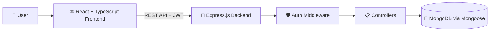

<div align="center">

# 🐞 Issue Tracker

### Full-Stack MERN Issue Management & Analytics Platform

A modern issue tracking application built with **React, TypeScript, Node.js, Express, and MongoDB**, featuring secure authentication, full CRUD, analytics dashboards, and a responsive UI.


🔐 JWT Auth &nbsp;•&nbsp; 📝 Full CRUD &nbsp;•&nbsp; 📊 Analytics Dashboard &nbsp;•&nbsp; 🔎 Search & Filters &nbsp;•&nbsp; 🌙 Dark / ☀️ Light Theme

</div>

---

## 📑 Table of Contents

- [Overview](#-overview)
- [Key Features](#-key-features)
- [Screenshots](#-screenshots)
- [Tech Stack](#️-tech-stack)
- [System Architecture](#️-system-architecture)
- [Project Structure](#-project-structure)
- [Getting Started](#-getting-started)
- [Security](#-security)
- [Known Limitations](#️-known-limitations)
- [Roadmap](#-roadmap)
- [Deployment](#-deployment)
- [Author](#-author)
- [License](#-license)

---

## 📖 Overview

**Issue Tracker** is a full-stack web application for creating, managing, and analyzing project issues. It was developed as a technical interview assignment and demonstrates real-world engineering practices: authentication, protected routes, REST API design, database integration, data filtering, analytics, and a reusable, component-based frontend written in TypeScript.

### 🌟 Highlights

- ✅ Full-stack MERN architecture
- ✅ JWT authentication and protected routes
- ✅ Complete issue CRUD with status tracking
- ✅ Search, filtering, and pagination
- ✅ Analytics dashboard
- ✅ Responsive UI with dark and light themes
- ✅ Reusable component architecture and scalable folder structure

---

## ✨ Key Features

### 🔐 Authentication
- User registration and login
- JWT-based authentication
- Password hashing with bcrypt
- Protected API and frontend routes
- Persistent user sessions

### 📝 Issue Management
- Create, view, edit, and delete issues (with delete confirmation)
- Update issue status through its lifecycle
- Search issues by keyword
- Filter by **status**, **priority**, and **severity**
- Paginated issue lists

| Supported Statuses |
|---|
| 🟢 Open |
| 🟡 In Progress |
| 🔵 Resolved |
| ⚫ Closed |

### 📊 Dashboard & Analytics
- Total, open, and resolved issue counts
- Priority distribution
- Status summary cards
- Visual analytics components

### 📤 Export
- Export issues as **CSV**
- Export issues as **JSON**

### 🎨 UI / UX
- Fully responsive layout
- Modern dashboard with sidebar navigation
- Smooth page animations with Framer Motion
- Dark / Light theme toggle
- Reusable UI components

### 👥 Application Modules

| Module | Purpose |
|---|---|
| 🏠 **Dashboard** | Overview of issue statistics |
| 📝 **Issues** | Create, manage, and track issues |
| 📊 **Analytics** | Visual trends and distributions |
| ⚙️ **Settings** | Application preferences |
| 👤 **Profile** | Authenticated user information |

---

## 📸 Screenshots

### 🏠 Dashboard
<p align="center">
  
</p>

### 📊 Analytics
<p align="center">
  
</p>

### 📝 Issues
<p align="center">
  
</p>

### ⚙️ Settings
<p align="center">
  
</p>

---

## 🛠️ Tech Stack

| Layer | Technologies |
|---|---|
| **Frontend** | ⚛️ React (Vite) · 🔷 TypeScript · 🎨 Tailwind CSS · 📦 Axios · 🧭 React Router DOM · ✨ Framer Motion |
| **Backend** | 🟢 Node.js · 🚂 Express.js · 🔑 JWT · 🔒 bcrypt.js |
| **Database** | 🍃 MongoDB · Mongoose ODM |

---

## 🏗️ System Architecture



---

## 📂 Project Structure

```bash
issue-tracker/
├── backend/
│   ├── controllers/    # Request handling logic
│   ├── middleware/     # Auth and validation middleware
│   ├── models/         # Mongoose schemas
│   ├── routes/         # API routes
│   ├── utils/          # Helper functions
│   └── server.js       # Server entry point
│
├── frontend/
│   └── src/
│       ├── api/        # Axios API layer
│       ├── components/ # Reusable UI components
│       ├── context/    # Global state (auth, theme)
│       ├── hooks/      # Custom hooks
│       ├── pages/      # Application pages
│       ├── utils/      # Helper functions
│       └── App.tsx
│
├── README.md
└── package.json
```

---

## 🚀 Getting Started

### Prerequisites
- Node.js and npm
- A MongoDB database (local or MongoDB Atlas)

### 1. Clone the repository

```bash
git clone https://github.com/DiluTharushika/issue-tracker.git
cd issue-tracker
```

### 2. Set up the backend

```bash
cd backend
npm install
```

Create a `.env` file in the `backend` folder:

```env
PORT=5000
MONGO_URI=your_mongodb_connection_string
JWT_SECRET=your_secret_key
```

Start the server:

```bash
npm run dev
```

### 3. Set up the frontend

```bash
cd frontend
npm install
npm run dev
```

> 🔐 Never commit your `.env` file or secrets to GitHub.

---

## 🔒 Security

- 🔑 JWT authentication
- 🔒 Password hashing with bcrypt
- 🛡️ Protected API routes
- ✅ Input validation
- 🗝️ Secrets kept in environment variables

---

## ⚠️ Known Limitations

> 🔔 The notification UI is implemented, but real-time backend integration is still pending. A **Socket.io** implementation is planned.

---

## 🔮 Roadmap

- [ ] 🔔 Real-time notifications (Socket.io)
- [ ] 💬 Comments and discussion system
- [ ] 📎 File upload support
- [ ] 🧑‍💼 Role-based access control (RBAC)
- [ ] 📊 Advanced analytics dashboard
- [ ] 📧 Email notifications
- [ ] 📱 Mobile application version

---

## ☁️ Deployment

The application can be deployed using:

- ▲ **Vercel** or **Netlify** for the frontend
- 🚆 **Render** or **Railway** for the backend
- 🍃 **MongoDB Atlas** for the database

---

## 👨‍💻 Author

**Dilu Tharushika**
Software Engineer | TypeScript · React · Node.js

[](https://github.com/DiluTharushika)
[](https://www.linkedin.com/in/dilutharushika/)
[](https://dilutharushika.github.io/my-portfolio/)

---

## 📄 License

This project was created for educational and technical interview assignment purposes.

---

<div align="center">

⭐ If you find this project useful, please consider giving it a star! ⭐

</div>
